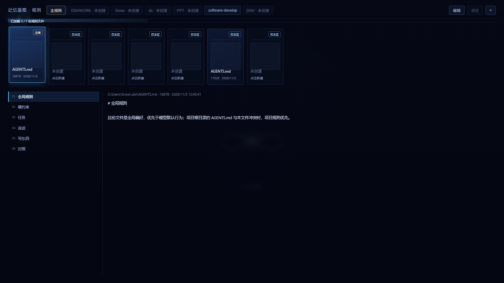

# 记忆星图 · dsh-memory-starmap

把 DSH 里的对话历史，画成一条八字形 + 莫比乌斯扭转的星带。星点就是记忆，带子自己在流动，中间一颗白亮的星核。

## 它现在是这个样子

- 形状：竖着的八字（长轴在 z）`C(t) = (0.68·sin 2t, B·sin 2t, A·cos t)`，腰部收细、两瓣拉长；宽度方向绕切线转 `t/2`，一圈下来正好翻个面，所以腰上会看到几股线交叉——这是莫比乌斯的那半个扭转
- 开场：2.6 秒动画，从腰部开始向两端铺开，星星一颗一颗亮，前沿有 10% 的渐亮不会切出硬边；数据没到也先画星带，节点随后淡入
- 光带：**三万两千颗星**本身，没有描边、没有贴图、没有任何连线。星星沿带子匀速流动，密度够了自然连成一条带
- 颜色：沿带子分段变色 —— 白、金、粉、紫、青、青绿轮着走，区间之间有一点随机抖动
- 每颗记忆星 = 一条消息（我发的 / 它答的），落在带上；位置**按时间排名摊开**，不是按绝对时间——对话是一阵一阵的，按绝对时间会把一整天的消息挤成一坨
- 记忆星：一条消息就是一颗，画成**小十字星芒**（2~4 像素，按重要度），尺寸按屏幕像素算、不跟透视缩放跑，放大也不会变成一坨白；没有暗底、没有光晕饼；搜索命中或选中时才套一个圈
- 流动：星带和记忆星共用同一个流动相位，一起沿带子走；点开一颗星时流动会慢慢停住，方便看
- 概要：星图上显示的是**第一句中文**（44 字以内，剥掉代码块、子代理消息前缀），点开才给全文；`dist < 2.4` 时按重要度浮出最多 14 条，鼠标悬停的那颗一直显示
- 边缘淡出：星星离画面边缘 90px 内逐渐变淡，带子被窗口边界裁到时不会是硬切
- 中间：白色星核，带十字星芒
- 左上角：翁法罗斯徽记，图片以 data URI 内联在 HTML 里（源文件 `public/brand.jpg` 还在，改图后重新内联即可），没有文字
- 左下角：**按工作区分组**，列的是工作区路径和该区的记忆条数，点一行就把它藏起来
- 点星 → 高亮 + **镜头平移并拉近到这颗星**（局部放大），右侧出全文、来源会话、连着的邻居；关掉面板镜头回到原位
- 搜一句话 → 命中的星亮环，左边列结果
- 滚轮缩放（触控板捏合同样生效）、拖拽转视角（可转到任意角度，含背面）、松手有惯性、双击复位

## 性能

- 星点：三万两千颗，位置从 1500 点查表 + 线性插值，绘制时按颜色分六组、每组只设一次 `fillStyle`
- 节点光晕：六张预渲染精灵图，不再每帧为每颗星建径向渐变
- 索引：会话级解析缓存（按 mtime 失效）+ 整库磁盘缓存 `.mobius/index.json`，冷建 1.0 秒，之后 18ms
- 插件启动 1.5 秒后在后台预热索引，第一次打开面板不用等

实测（headless Chrome、`--disable-gpu` 纯软件光栅，最差情况）：约 32 fps，写这个数的脚本在 `scripts/fps-check.mjs`。

## 数据从哪来

`~/.dsh/sessions/<workspace>/<session>/session.v4.jsonl.zstd`，只读。

DSH 每次追加写一个 zstd frame，所以解压时按魔数 `28 B5 2F FD` 切帧再逐个解，半帧直接跳过。取 `user/message` 和 `assistant/message` 的 text 块，丢掉 `reme-memory` 注入的说明、system-reminder 和标题型系统提示。

## 六层

| 层 | 颜色 | 落点 v | 判定关键词（举例） |
|---|---|---|---|
| 身份 soul | 金 | -0.72 | 我是 / 我叫 / 我习惯 |
| 规矩 rules | 青 | -0.44 | 不要 / 必须 / 以后 / 记住 |
| 项目 project | 紫 | -0.15 | dsh / 插件 / 代码 / 接口 |
| 事件 event | 粉 | +0.15 | 今天 / 上次 / 试了 / 报错 |
| 知识 fact | 绿 | +0.44 | 原理 / 算法 / 结论 |
| 感受 feeling | 橙 | +0.72 | 喜欢 / 烦 / 累 / 希望 |

分类是关键词规则，不是模型判断。认错层的星会有，但目前没打算为它加一层 LLM 调用。

## 检索

沿用 memory-star 的算法骨架：

1. 中文取字二元组、英文取 2 字符以上词，去停用词
2. 口语说法做同义扩展（权重 0.42）
3. IDF 加权，`log((N+1)/(df+0.5))`
4. 时间衰减 `0.55 + 0.45·e^(-age/180天)`（来自 constellation-engine 的边衰减思路）
5. 直接命中拿全分，沿连线一圈的邻居拿 `命中分 × 边权 × 0.4`

`/mobius/api/recall?q=&k=&budget=` 直接吐一段 `<memory>...</memory>`，可以塞进上下文给模型用。

**按字数预算裁剪，不按条数**（借的 dsh-cyrene-theme 的做法）：从最相关的一条往后累加，`budget`（默认 2200 字）装不下就停。第一条就装不下、但还剩 160 字以上时，会把它截断塞进去——总比整段空着强。被裁掉的条目仍然留在索引里，换个 query 还能搜到。返回里带 `used` / `budget` / `dropped`，方便判断是不是该调大预算。

## 诊断

排查"卡顿 / 白屏"不用再靠截图猜了。页面每 5 秒把一次快照 POST 到 `/mobius/api/report`，宿主只存内存、不落盘：

```bash
curl http://127.0.0.1:8787/api/report
```

```json
{"at":1793930527576,"report":{"kind":"mobius-report","fps":46.2,"canvas":[1578,746],
 "dpr":1,"nodes":1057,"dist":5.9,"intro":1,"errors":[],"ts":1793930527574}}
```

`fps` 是这 5 秒里的实际帧率，`errors` 是页面捕获到的最近 3 条异常。请求体上限 128KB，坏 JSON 回 400，任何一步失败都只影响诊断。

## 什么时候生效

| 改的是什么 | 生效方式 |
| --- | --- |
| `public/index.html` 里的画面/交互 | **刷新页面**（宿主每次请求都现读文件） |
| `lib/store.js`（索引、检索、概要与预算） | 重启 DSH 或重载插件行（Node 模块只在启动时载入） |
| `lib/index.js`（路由、预热、诊断接口） | 重启 DSH |
| `.mobius/` 里的缓存 | 删掉即重建（冷建约 1 秒） |
| `SCHEMA` 常量 +1 | 旧缓存自动作废，不用手删 |
| 面板里「不再显示 / 改概要」 | **立刻**（写覆盖层 + 重新拉图，不重建索引） |
| `package.json` 的 `icon` / 包名 | 重启 DSH（插件列表在启动时读） |
| `lib/model.js`（工具与提示词） | 重启 DSH（工具在启动时注册） |
| `lib/rules.js`（规则区接口） | 重启 DSH（路由在启动时注册；页面本身刷新就更新） |
| 手改 `~/.dsh/mobius-memory.json` | 下次读就是新的（按 mtime 判断） |

## 写入（隐藏 / 改概要）

面板里点开一颗星，右边有两个按钮：**不再显示**、**改概要**。

用户数据单独一个文件，和缓存分开：

```
~/.dsh/mobius-memory.json      # 用户覆盖层（删掉 = 全部恢复）
{ "rev": 5, "hidden": ["f554f8-40"], "summaries": { "f554f8-40": "我自己写的概要" } }
```

- `hidden`：被隐藏的条目 id，图和检索里都不再出现；左下角会显示「隐藏 N」，点一下全部恢复
- `summaries`：手动改过的概要，优先于自动生成的那条
- `rev`：每次成功写入 +1

**写入走乐观并发**：请求必须带上 GET 拿到的 `rev`，缺了回 `400 client-outdated`，过期回 `409 stale`——开着的旧页面不可能把别处刚做的改动盖回去。冲突时前端会自动重新拉一遍图，再让你重试。

覆盖层只影响"看什么"，不动 `.mobius/` 里的索引；所以隐藏一条不需要重建，立刻生效。

接口：

| 路由 | 说明 |
|---|---|
| `GET /mobius/api/overrides` | 当前覆盖层（rev / hidden / summaries） |
| `POST /mobius/api/overrides` | `{ rev, action, id?, text? }`，action = `hide` / `unhide` / `summary` / `reset` |

## 跑起来

独立跑（不装 DSH 也能看）：

```bash
cd mobius-memory
node bin/serve.js          # → http://127.0.0.1:8787
```

装进 DSH 当插件（Web 端 profile 叫 `web`，桌面端叫 `desktop`）：

```bash
cd ~/.dsh/profiles/web
pnpm add link:D:/DSHWORK/mobius-memory
```

然后让它进 `dsh.profile.bundles`——`dsh plugin add` 只是转发给 pnpm，不会做这一步，包在 `node_modules` 里躺着但不会被加载：

```bash
node node_modules/dsh-memory-starmap/bin/enable.mjs web
```

（脚本会先备份 profile 的 `package.json`，重复跑是幂等的。）最后重启 DSH。

**用 GUI 装就不用这一步。** 「设置 → 插件 → 添加」那个流程装完会自动扫描新依赖，凡是声明了 `dsh.bundle` 的包都会被写进 `bundles`——本包声明了，所以装完直接重启即可。

用 `link:` 而不是 `file:`：file 是拷贝，改源码不生效；link 是指过来，改完重启就生效。

## 分享给别人

包名 `dsh-memory-starmap`（npm 只收小写，所以不是 `dsh-memory-Starmap`）。

插件列表和卡片上的图标来自 `package.json` 的 `icon` 字段（相对路径、必须留在包内、svg/png/jpeg/webp、≤256KB），宿主会读成 base64 data URL 直接渲染。现在是 `"icon": "public/brand.jpg"`，也就是左上角那个翁法罗斯徽记。三种方式，按"对方要多久用上"排：

**一、发一个 tarball（最快，适合一两个朋友）**

```bash
npm pack                      # 生成 dsh-memory-starmap-0.1.0.tgz，约 180KB
```

把 `.tgz` 发给对方，他在自己机器上：

```bash
dsh plugin --profile desktop add file:C:\path\dsh-memory-starmap-0.1.0.tgz
```

然后打开 `~/.dsh/profiles/desktop/package.json`，在 `dsh.profile.bundles` 末尾加 `"dsh-memory-starmap"`，重启 DSH 桌面端，侧栏出现图标。

**二、发 GitHub 仓库（对方能跟着改动走）**

```bash
dsh plugin --profile desktop add github:<你的帐号>/dsh-memory-starmap
```

同样要手动加 bundles 那一行。这种方式跟的是默认分支最新提交，不用发版。

**三、发 npm（长期、别人能搜到）**

```bash
npm publish --access public
```

之后任何人：

```bash
dsh plugin --profile desktop add dsh-memory-starmap
```

再加 bundles 那一行、重启。包内容由 `package.json` 的 `files` 控制：现在带 `lib/`、`public/index.html`、`public/brand.jpg`、`bin/serve.js`、`cordis.patch.yml`、`README.md`，共 8 个文件、253KB 解包后。

**对方还需要什么**

DSH ≥ 0.2.0-rc.1（`dsh.engines` 里写着）、Node ≥ 22.5（桌面端自带）。插件零依赖，不需要装任何别的包。

**不会跟着过去的**

- `~/.dsh/mobius-memory.json`（隐藏/改过的概要）是本机的，不随包分发
- `.mobius/` 索引缓存也是本机的，对方第一次打开会自己重建（约 1 秒）
- 素材只有 `public/brand.jpg` 那一张，没有别的图片依赖

冒烟测试（不装 DSH，假 ctx 挂真 http server）：

```bash
node test/smoke.mjs
```

## 规则区（三幕）

点星图正中那颗白亮的星核，整块星图会定格、缩到屏幕中央，变成一枚 **172px 的 ∞ 徽标**（= 侧栏徽记的 2 倍）。悬停时光沿外环扫一圈，单击选中，再点一下展开规则区。




规则区面板里：

- 顶栏 **7 个标签全排开、横向滚动**：主规则钉在最左不随滚动，右边 6 个工作区按最近会话时间排
- 中段是一排竖向玻璃板，一块 = 一个 `AGENTS.md`；有文件的显示大小和日期，没有文件的显示「未创建」，点一下能建
- 主规则角标是「全局」，工作区是「仅本区」——把分级写在明面上
- 下段左列是选中文件的标题小节，右边是正文，默认只读
- 点「编辑」才进编辑态，第一次会确认一次；保存前自动备份成 `AGENTS.md.bak-<时间戳>`

它读的和写的就是这些文件：

```
~/.dsh/AGENTS.md          全局，对所有会话生效
<工作区>/AGENTS.md         只在该目录下的会话生效，冲突时项目优先
```

接口：

```
GET  /mobius/api/rules              文件清单 + 小节
GET  /mobius/api/rules/file?path=   单文件全文
POST /mobius/api/rules/file         写回（mtime 冲突返回 409，改前备份，路径白名单）
```

ESC 逐层退出：面板 → 选中态 → ∞ → 星图。

## 喂给模型（工具与提示词）

宿主有 `tools` 服务时，插件注册一个工具 **`mobius_recall`**，并往系统提示词里塞一段**一行索引**（`mobius:index`，order 480）。没有这两个服务时整块安静跳过（等 20 秒，拿不到就放弃），不影响页面。

```
mobius_recall({ query: "莫比乌斯 撤销", limit?: 5, budget?: 800 })
```

返回给模型的样子：

```
<memory source="本地对话索引" note="原文摘录，可能已过时；和本轮说法冲突时以本轮为准。用户说的算事实，助手说的只是当时的判断。">
1. [2026-11-05 · 用户说的 · 记忆库搭建] 三处反馈我都记下了…
2. [2026-11-05 · 助手当时说的 · 记忆库搭建] 改完了，当前效果…
</memory>
```

几条刻意的设计：

- **只按需调用**，不做每轮自动注入
- **分信任等级**：每条标出「用户说的」还是「助手当时说的」——前者算事实，后者只算当时的判断；排序时用户的话再乘 1.25，因为一条“引用过查询词”的助手消息很容易压过用户给出的真正结论
- **默认 800 字预算**（上限 2000），带 `used` / `dropped`
- **不硬凑**：命中要同时满足分数、覆盖率（`coverage ≥ 0.25`）、查询词可识别比例（`known ≥ 0.5`）三条；都不满足就直说"没有足够相关的记录"
- **空 query** 返回最近几条，但标 `fallback: true` / `mode="recent-fallback"`，不冒充命中
- 索引不可用、检索抛错、超过 5 秒，都会明确说明而不是给空结果

一个已知的自我指涉问题：如果某段对话本身在讨论这次查询（比如「记忆星 概要 搜错了」），它会被索引收录，然后成为下次查询的高分结果——属实但没用。缓解是用户加权加上每条截短到 160 字，让真正的答案能挤进前三条；没有从根上解决。

`MOBIUS_TOOL=0` 可以整体关掉工具与提示词注入。

验收（不装 DSH，假 ctx）：

```bash
node test/tool.mjs
```

四道题：放弃严格莫比乌斯的原因、记忆星显示的是概要、节点曾经只有一颗的 bug、以及一个完全没聊过的话题必须答"没查到"。

## 接口

| 路由 | 说明 |
|---|---|
| `GET /mobius/app` | 星图页面 |
| `GET /mobius/api/graph` | 全量节点 + 边 |
| `GET /mobius/api/search?q=` | 检索，返回 id / index / score |
| `GET /mobius/api/node?id=` | 单块原文 + 邻居 |
| `GET /mobius/api/recall?q=&k=&budget=` | 给模型用的召回文本（按字数预算裁剪） |
| `GET/POST /mobius/api/overrides` | 隐藏 / 改概要的用户覆盖层（带 rev） |
| `POST /mobius/api/report` | 页面推诊断快照（帧率 / 画布 / 报错），只存内存 |
| `GET /mobius/api/report` | 读回最后一份诊断 |

只对 loopback 开放，非本机地址一律 403。

## 自检

```bash
node test/smoke.mjs
```

除了接口，还盯着几条**踩过的坑**——这些断言的意义是让同样的 bug 别回来：

- `project()` 必须返回拷贝（曾经复用一个对象，1057 颗记忆星叠成一颗）
- `drawNodes` 结束、`drawSky` 开头都要复位 `globalCompositeOperation`（曾经 `lighter` 漏到下一帧，背景越叠越白）
- `bin/serve.js` 的静态文件必须带 `no-store`（曾经改完代码刷不出新页面）
- 不再使用 `destination-out` 挖暗底
- recall 的预算真的会把 `used` 压在 `budget` 以内
- 写入：隐藏后条目从图里消失、边重映射不越界、`rev` 缺 400 过期 409、数据落在 `$DSH_HOME`
- 冒烟测试把 `DSH_HOME` 指到临时目录，不碰真实的 `~/.dsh`

## 综合了谁

| 来源 | 拿了什么 |
|---|---|
| [hlwzm/memory-star](https://github.com/hlwzm/memory-star) | 分块、词表、IDF、同义扩展、沿边扩一圈、零依赖 |
| [yuyun-git/dsh-meow-constellation](https://github.com/yuyun-git/dsh-meow-constellation) | DSH 宿主路由注册、只读 + loopback 约束、Canvas 2D 手写投影 |
| [CONSTELLATION-ENGINE/constellation-engine](https://github.com/CONSTELLATION-ENGINE/constellation-engine) | 时间衰减、扩散激活（邻居加权） |
| [zoey1yang/MemoryConstellations](https://github.com/zoey1yang/MemoryConstellations) | 分层星座的组织方式（星系 / 星座 / 记忆） |
| [berhbro/dsh-cyrene-theme](https://github.com/berhbro/dsh-cyrene-theme) | 召回按字数预算裁剪、诊断旁路（页面主动上报）、把踩过的坑写成回归断言、生效时机表 |

## 还没做

- 抽取层还是规则：没有把一段对话压成一句事实的步骤，现在一条消息就是一颗星
- 没做增量：每次启动全量重扫 52 个会话，约 1 秒；会话上千条后需要落盘缓存
- 没做向量召回：纯词法，近义改写会漏
- 没做移动端

MIT
